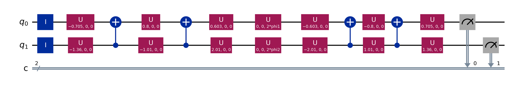
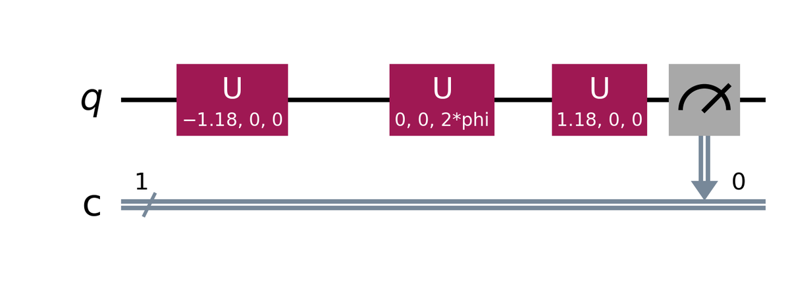
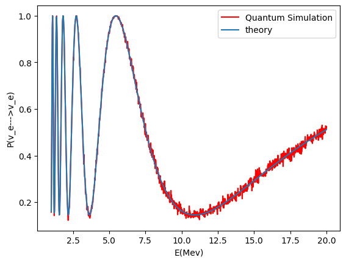
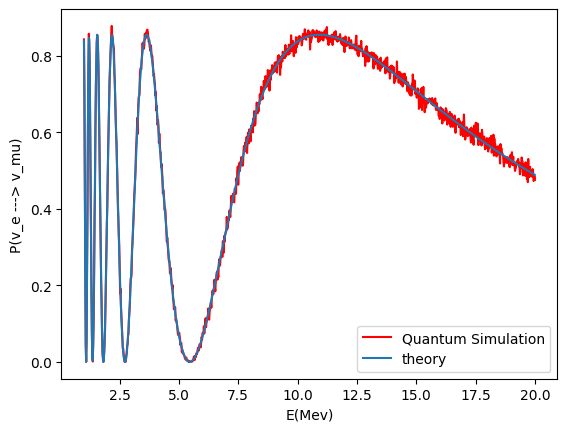
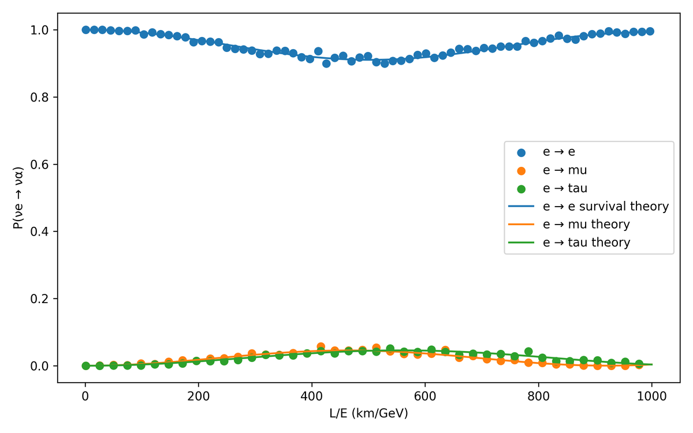
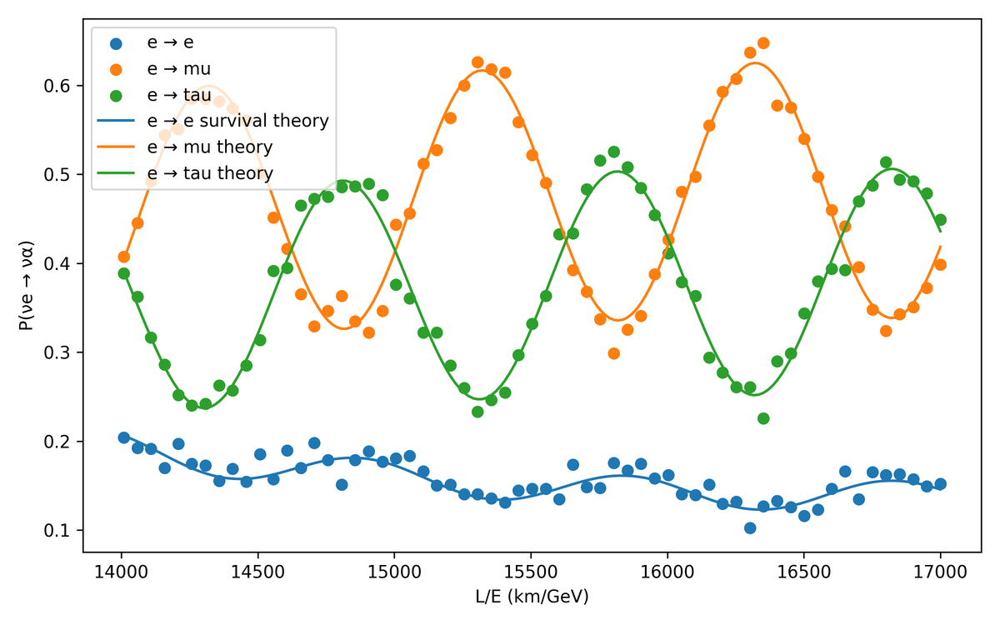
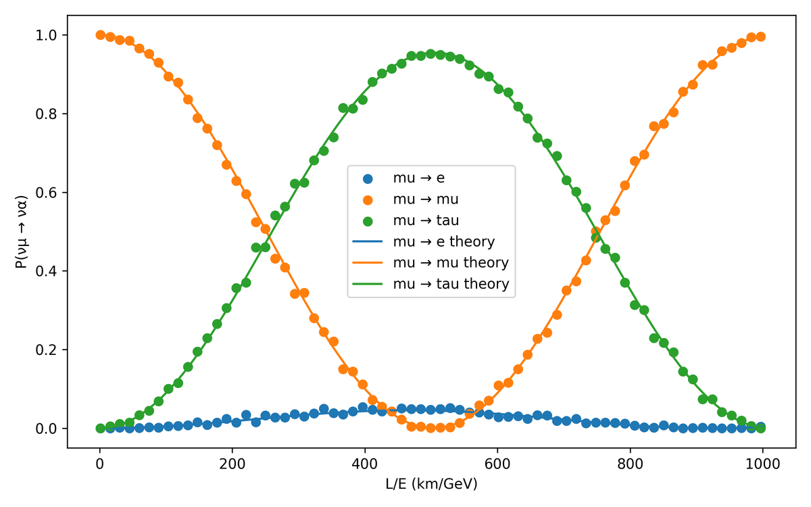
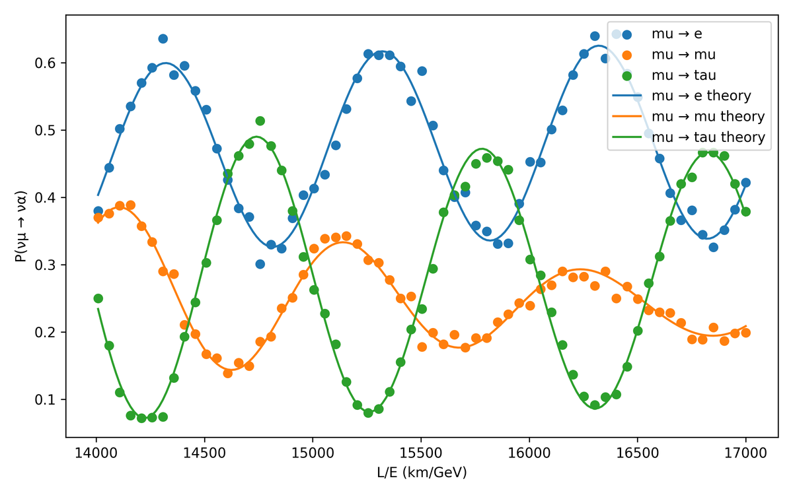
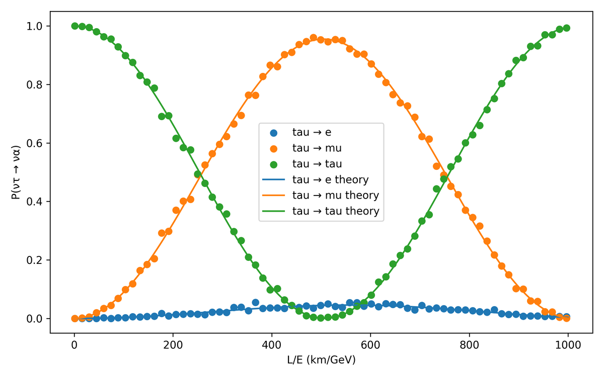
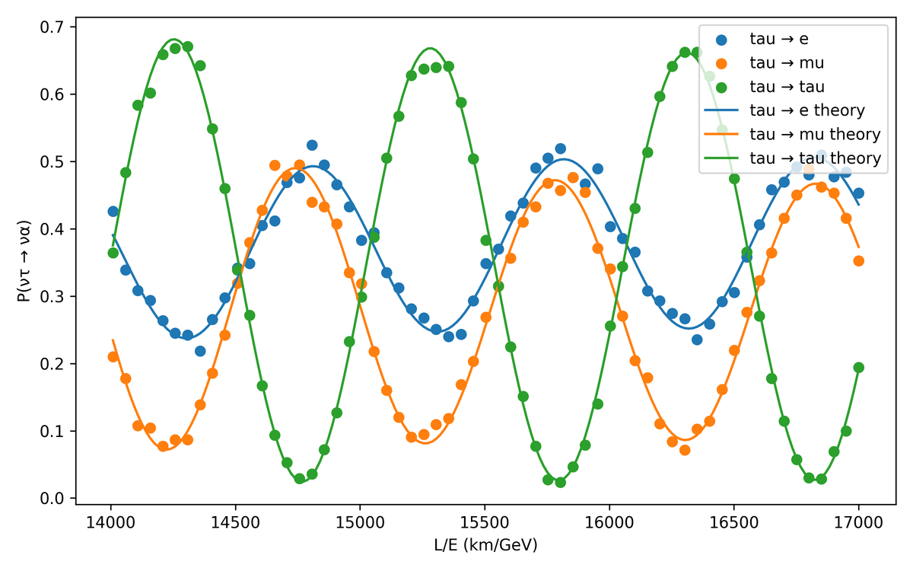

# Neutrino Oscillation on a Quantum Processor

Quantum circuits that simulate neutrino flavor oscillations, written in Qiskit and checked against the analytic oscillation probabilities.

This repository holds my Bachelor of Science (Research) thesis and the notebooks behind its figures.

- **Author:** Wangshitemjen Ozukum, Undergraduate Programme, Indian Institute of Science
- **Supervisor:** Prof. Ranjan Laha, Centre for High Energy Physics, Indian Institute of Science
- **Degree:** Bachelor of Science (Research) in Physics
- **Submitted:** April 2026

**[Read the thesis (PDF)](thesis/Neutrino_Oscillation_on_a_Quantum_Processor.pdf)** · [Circuits notebook](notebooks/neutrino_oscillation_circuits.ipynb) · [Gate-angle fit notebook](notebooks/pmns_gate_angle_fit.ipynb)

<p align="center">
  
</p>
<p align="center"><em>The two-qubit circuit for three-flavor oscillations of an electron neutrino (thesis Fig. 5.1).</em></p>

## Summary

A neutrino is produced in a flavor state (ν<sub>e</sub>, ν<sub>μ</sub> or ν<sub>τ</sub>), which is a superposition of three mass states. Each mass state picks up its own phase as the neutrino travels, so the flavor found at the detector oscillates with distance over energy, *L/E*.

This is unitary evolution of a very small quantum system, so it can be written directly as a quantum circuit:

```math
U_\text{total} = U_\text{PMNS}\; U_\text{prop}\; U_\text{PMNS}^\dagger
```

1. U<sub>PMNS</sub><sup>†</sup> takes the initial flavor state to the mass basis.
2. U<sub>prop</sub> is diagonal. Phase gates give each mass state its phase, which depends on *m*<sub>i</sub><sup>2</sup>*L*/2*E*.
3. U<sub>PMNS</sub> rotates back to the flavor basis, and measuring the qubits gives the flavor.

*N* flavors need only ⌈log<sub>2</sub> *N*⌉ qubits: one qubit for two flavors, and two qubits for three flavors or for three flavors plus a sterile neutrino.

The thesis follows the construction of Argüelles and Jones [1], derives every step explicitly, and verifies the two- and three-flavor circuits with Qiskit simulations.

## What the thesis covers

| Chapter | Case | Qubits | Circuit | Code here |
|:---:|---|---|---|:---:|
| 4 | Two flavors | 1 | `U3(−2θ)`, phase gate `S(φ)`, `U3(2θ)` | ✓ |
| 5 | Three flavors | 2 | PMNS from six `U3` rotations and two CNOTs. Propagation is two single-qubit phase gates, with no entangling gate | ✓ |
| 6 | Sterile neutrino (3+1) | 2 | Propagation becomes entangling: two CNOTs and three phase gates | – |
| 7 | Decoherence | system + 1 ancilla | Controlled rotation of the ancilla, `CNOT · U3(θ) · CNOT · U3(−θ)`, with cos θ = e<sup>−γL</sup> | – |
| 8 | Matter effects (two flavors) | 1 | The vacuum circuit with θ and Δm² replaced by their values in matter | – |
| 9 | CP violation | 2 | The PMNS circuit with extra phase gates. Antineutrinos are simulated by δ<sub>CP</sub> → −δ<sub>CP</sub> | – |

The notebooks in this repository cover Chapters 4 and 5 and the gate-angle fit of Appendix A. Chapters 6 to 9 are presented in the thesis.

## Results

### Two flavors on one qubit

<p align="center">
  
</p>

With the mass states |ν<sub>1</sub>⟩ and |ν<sub>2</sub>⟩ as |0⟩ and |1⟩, propagation is a single phase gate with φ = Δm²*L*/2*E*, and the probability of measuring `0` is the survival probability:

```math
P(\nu_e \to \nu_e) = 1 - \sin^2 2\theta \, \sin^2\!\left(\frac{\Delta m^2 L}{4E}\right)
```

| ν<sub>e</sub> → ν<sub>e</sub> | ν<sub>e</sub> → ν<sub>μ</sub> |
|:---:|:---:|
|  |  |

*Probability against neutrino energy (MeV) at L = 180 km. Red: circuit simulation, 1024 shots per point. Blue: analytic formula. Thesis Figs. 4.3 and 4.4.*

### Three flavors on two qubits

The 3 × 3 PMNS matrix is embedded in a 4 × 4 two-qubit unitary that leaves the unused state |11⟩ alone. It is built from six single-qubit rotations and two CNOTs:

```math
U_\text{PMNS} = \big(U_3^A(\epsilon)\otimes U_3^B(\zeta)\big)\,\text{CNOT}\,\big(U_3^A(\gamma)\otimes U_3^B(\delta)\big)\,\text{CNOT}\,\big(U_3^A(\alpha)\otimes U_3^B(\beta)\big)
```

The six angles come from a numerical fit ([`pmns_gate_angle_fit.ipynb`](notebooks/pmns_gate_angle_fit.ipynb)), which reproduces the target matrix to better than 10<sup>−6</sup> in every element.

Propagation needs no entangling gate. The phase of the unused state |11⟩ is free, and choosing it as the sum of the other two turns the diagonal evolution into a product of two single-qubit phase gates:

```math
\text{diag}\left(1,\; e^{i\phi_B},\; e^{i\phi_A},\; e^{i(\phi_A+\phi_B)}\right) = S_A(\phi_A)\otimes S_B(\phi_B),
\qquad \phi_A = -\frac{\Delta m^2_{31} L}{2E},\quad \phi_B = -\frac{\Delta m^2_{21} L}{2E}
```

The full circuit has 12 single-qubit rotations, 4 CNOTs and 2 phase gates. Measuring |00⟩, |01⟩ or |10⟩ gives ν<sub>e</sub>, ν<sub>μ</sub> or ν<sub>τ</sub>. With a sterile neutrino the fourth state is physical, its phase is fixed by Δm²<sub>41</sub>, and propagation has to entangle the two qubits (Chapter 6).

| Initial flavor | *L/E* from 1 to 1000 km/GeV | *L/E* from 14000 to 17000 km/GeV |
|:---:|:---:|:---:|
| ν<sub>e</sub> |  |  |
| ν<sub>μ</sub> |  |  |
| ν<sub>τ</sub> |  |  |

*Points: circuit simulation, 1024 shots per point. Lines: analytic three-flavor probabilities. Thesis Figs. 5.4 to 5.9.*

At small *L/E* only the larger splitting Δm²<sub>31</sub> has had time to act, and the oscillation is mostly between ν<sub>μ</sub> and ν<sub>τ</sub>. At large *L/E* the smaller splitting Δm²<sub>21</sub> contributes as well and all three flavors mix.

## Repository layout

```
.
├── thesis/
│   └── Neutrino_Oscillation_on_a_Quantum_Processor.pdf
├── notebooks/
│   ├── neutrino_oscillation_circuits.ipynb    two- and three-flavor circuits and plots (thesis ref. [14])
│   └── pmns_gate_angle_fit.ipynb              fit of the six PMNS gate angles (thesis ref. [15])
├── figures/                                   thesis figures shown in this README
└── requirements.txt
```

The PDF is the thesis as submitted, with the handwritten signatures and my student registration number removed from the certificate and declaration pages.

**[`neutrino_oscillation_circuits.ipynb`](notebooks/neutrino_oscillation_circuits.ipynb)**

| Section | Content | Thesis figures |
|:---:|---|---|
| 1.1 | Two flavors, initial ν<sub>e</sub>: survival and appearance | 4.1, 4.3, 4.4 |
| 1.2 | Two flavors, initial ν<sub>μ</sub> | 4.2 |
| 1.3 | Check that the two probabilities add up to 1 | 4.5 |
| 2.1 to 2.6 | Three flavors, initial ν<sub>μ</sub>, ν<sub>e</sub> and ν<sub>τ</sub>, each at small and large *L/E* | 5.1 to 5.9 |

**[`pmns_gate_angle_fit.ipynb`](notebooks/pmns_gate_angle_fit.ipynb)** finds the six `U3` angles of the PMNS circuit with a global search followed by a least-squares refinement (thesis Appendix A.2).

## Running the notebooks

```bash
git clone https://github.com/SingleMaltMaverick/Neutrino-oscillation-on-a-quantum-processor. neutrino-oscillation
cd neutrino-oscillation
python -m venv .venv
source .venv/bin/activate
pip install -r requirements.txt
jupyter notebook notebooks/
```

Every cell is self-contained, so cells can be run in any order. The circuits notebook takes about 20 seconds to run in full. On Google Colab, upload a notebook and run `!pip install qiskit pylatexenc` first.

Tested with Python 3.13, Qiskit 2.6, NumPy 2.5, SciPy 1.18 and Matplotlib 3.11.

## Simulation settings

| | Two flavors | Three flavors |
|---|---|---|
| Mixing | θ = 0.59 rad | Real PMNS matrix below (δ<sub>CP</sub> = 0) |
| Mass splittings | Δm² = 7.5 × 10<sup>−5</sup> eV² | Δm²<sub>21</sub> = 7.4 × 10<sup>−5</sup> eV², Δm²<sub>31</sub> = 2.5 × 10<sup>−3</sup> eV² |
| Scan | *E* from 1 to 20 MeV at *L* = 180 km | *L/E* from 1 to 1000 km/GeV and from 14000 to 17000 km/GeV |
| Sampling | 1024 points, 1024 shots per point | 1024 points, 1024 shots per point |
| Backend | `qiskit.primitives.StatevectorSampler` | `qiskit.primitives.StatevectorSampler` |

```math
U_\text{PMNS} = \begin{pmatrix} 0.821427 & 0.550313 & 0.149708 \\ -0.481513 & 0.528538 & 0.699138 \\ 0.305618 & -0.646377 & 0.699138 \end{pmatrix}
```

`StatevectorSampler` draws shots from the exact state vector, so the scatter of the simulated points around the analytic curves is statistical shot noise.

## Citing

```bibtex
@mastersthesis{ozukum2026neutrino,
  author  = {Ozukum, Wangshitemjen},
  title   = {Neutrino Oscillation on a Quantum Processor},
  school  = {Indian Institute of Science},
  address = {Bangalore, India},
  type    = {{B.Sc.} (Research) thesis},
  year    = {2026},
  month   = apr,
  note    = {Supervisor: Prof. Ranjan Laha}
}
```

## References

The full bibliography is in the thesis. The works this repository relies on most directly:

1. C. A. Argüelles and B. J. P. Jones, "Neutrino oscillations in a quantum processor", [Phys. Rev. Research 1, 033176 (2019)](https://doi.org/10.1103/PhysRevResearch.1.033176).
2. F. Vatan and C. Williams, "Optimal quantum circuits for general two-qubit gates", [Phys. Rev. A 69, 032315 (2004)](https://doi.org/10.1103/PhysRevA.69.032315).
3. A. Dighe, "Neutrino Physics: an Introduction", [arXiv:hep-ph/0510213](https://arxiv.org/abs/hep-ph/0510213).
4. M. A. Nielsen and I. L. Chuang, *Quantum Computation and Quantum Information*, Cambridge University Press (2010).

## Acknowledgements

I am grateful to my advisor, Prof. Ranjan Laha, for his guidance and support throughout this project, and to the Centre for High Energy Physics, Indian Institute of Science, for the research environment and computational resources. The thesis uses a LaTeX template by [Biplab Mahato](https://github.com/biplab37/Project-Report/tree/master/UG%20thesis/Thesis%20Report).
